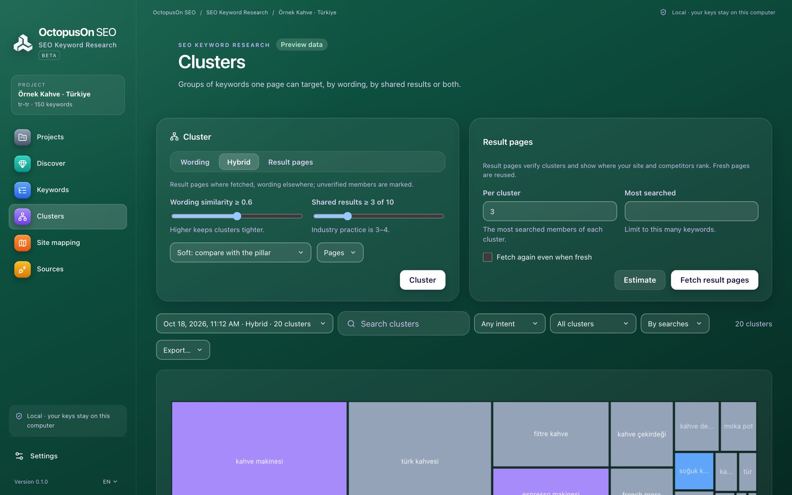

# OctopusOn SEO Keyword Research

A free keyword research tool with keyword clustering: collect ideas from Google Ads, Search Console, Wordstat, autocomplete and your exports, group them by SERP overlap and map every cluster to a page.

**100% free and open source** (no paid version, no trial, no limits) · for SEO and GEO (visibility in AI answers) · Windows, macOS and Linux · updated continuously as search engines and AI assistants change.



## Download

Get the installer for your system from the [latest release](../../releases/latest): `.dmg` for macOS (Apple Silicon and Intel), `.msi` or `.exe` for Windows, `.AppImage`, `.deb` or `.rpm` for Linux. More on [octopuson.com](https://octopuson.com/en/seo-keyword-research).

## What it does

### Keyword ideas from the sources you trust

Combine Google data, Yandex data and your own exports in one list, without duplicates.

- Google Ads Keyword Planner and Search Console with your own Google sign-in
- DataForSEO ideas, volumes, difficulty, intent and competitor keywords; SerpApi autocomplete
- Yandex Wordstat for Yandex markets
- Free Google and Yandex autocomplete, off by default and rate-limited
- Seed expansion with a–z, question words and buying words in Turkish and English

### Keyword clustering by SERP overlap

Keywords that share the same top-10 results can be targeted by one page.

- Clustering by wording: free, about 2 seconds for 50,000 keywords
- Clustering by search results, soft or hard, by page or by site
- Hybrid clustering that combines both
- Your manual moves survive later re-clustering

### Keyword mapping and content planning

Turn clusters into pages: what to update, what to write and where pages compete.

- A target page for every cluster, with cannibalisation and gaps
- Top competitors for each cluster
- Content briefs with questions, related searches and top pages
- Intent, difficulty and CPC on every cluster

### Bring your existing keyword lists

Keep the research you already paid for and organise it here.

- Imports from Ahrefs, Semrush, Keyword Planner, Search Console and Wordstat: CSV, TSV, TXT, XLSX or a Search Console ZIP
- Variants that differ only in case, accents or spacing merge into one keyword
- The latest 10 clusterings are kept
- Excel, CSV and JSON exports

## Command line

Every feature also works from the terminal with `octopuson-keywords`, included in the release archives:

```bash
octopuson-keywords import 1 ahrefs-keywords.csv
octopuson-keywords cluster 1 --method hybrid
octopuson-keywords export clusters 1 clusters.xlsx
```

## Your own APIs or OctopusOn credits

Everything that runs on your computer is free. Search APIs are optional: connect your own keys (DataForSEO, Serper, SerpApi, Yandex), or use all of them with prepaid credits through one connection at [my.octopuson.com](https://my.octopuson.com).

## Source code and issues

This project publishes the releases of the SEO Keyword Research. Its source code lives in [octopusOn/octopusOnPageSEO](https://github.com/octopusOn/octopusOnPageSEO), together with the engine every OctopusOn SEO program shares. Bug reports and ideas are welcome in this project's issues.

## Licence

MIT or Apache-2.0, at your option.
